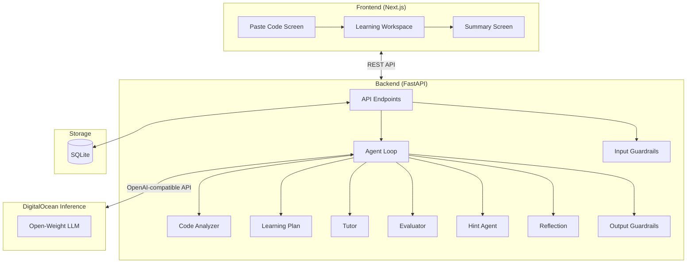
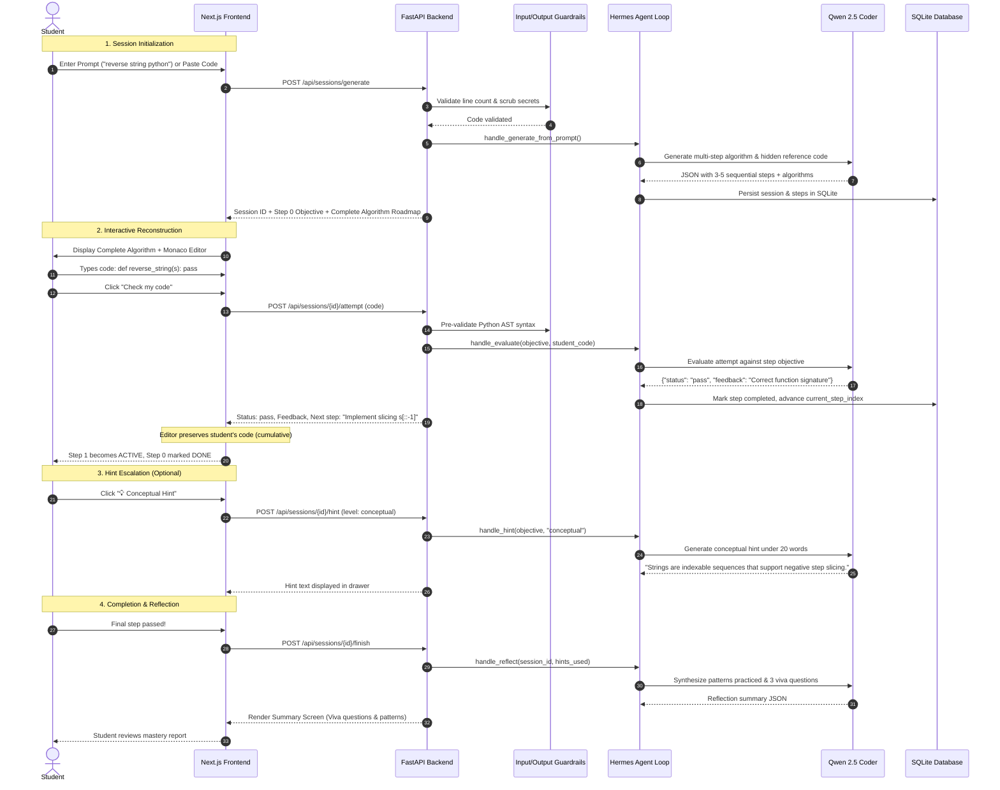

# VibeBreaker System Architecture (`ARCH.md`)

> **Anti-Vibe-Coding Learning Platform**  
> An open-weight multi-agent pairing system that converts raw Python code or natural language ideas into structured, step-by-step algorithmic reconstructions so students actually learn what they build.

---

## 1. System Architecture Diagram

---

## 2. AI Models Used & Inference Setup

VibeBreaker is built specifically for the **Open-Source / Open-Weight AI Models** track. It operates entirely on open-weight LLMs with zero proprietary vendor lock-in.

### 2.1 Primary Model: Qwen 2.5 Coder
- **Model Identifier**: `qwen/qwen3.8-27b` (via Groq OpenAI-compatible inference) / `qwen2.5-coder-32b-instruct` (via DigitalOcean GenAI Inference).
- **Architecture**: Open-weight dense transformer fine-tuned specifically on high-quality code, mathematical reasoning, and multi-turn instruction following.
- **Why Qwen 2.5 Coder?**:
  1. **Strict Algorithmic Dissection**: Exceptional capability to transform complex code or prompts into clean, numbered, plain-English algorithms without prematurely revealing the solution.
  2. **Accurate Syntax & Semantic Evaluation**: Capable of evaluating partial student attempts, distinguishing variable assignment from function declarations, and providing constructive feedback in under 20 words.
  3. **Structured JSON Adherence**: Reliably returns strict JSON schemas for seamless backend parsing.

### 2.2 Inference Providers Supported
1. **Groq Inference Cloud (Default / Recommended - 100% Free)**:
   - **Base URL**: `https://api.groq.com/openai/v1`
   - **Model**: `qwen/qwen3.8-27b` (or `openai/gpt-oss-120b`)
   - **Zero Payment Requirement**: Accessible instantly with a free developer key without entering any credit card or billing details.
   - **Performance**: High-speed LPU inference (~250–400 tokens/sec), ensuring near-instant evaluation and hint generation.
2. **DigitalOcean GenAI Inference**:
   - **Base URL**: `https://inference.do-ai.run`
   - **Model**: `qwen2.5-coder-32b-instruct` / `llama-3.3-70b-versatile` / `deepseek-coder`
   - **Protocol**: Fully OpenAI-compatible chat completions endpoint (`/v1/chat/completions`).

### 2.3 Deterministic Offline Fallback Synthesizer
- Built directly into [`AgentLoop._synthesize_prompt_solution`](file:///d:/Projects/VibeBreaker/api/app/services/agent_loop.py) and [`AgentLoop._fallback_output`](file:///d:/Projects/VibeBreaker/api/app/services/agent_loop.py).
- If network timeouts or authentication issues occur, the system automatically falls back to an intelligent AST-based synthesizer with tailored domain logic (e.g., string slicing, prime generation, math statistics), guaranteeing zero application crashes.

---

## 3. Detailed Function of Each Module

### 3.1 Frontend Subgraph (Next.js 14 & React)

| Module | File | Function & Responsibilities |
| :--- | :--- | :--- |
| **`A[Paste Code Screen]`** | [`PasteCodeScreen.tsx`](file:///d:/Projects/VibeBreaker/web/components/PasteCodeScreen.tsx) | **Initial Entry Screen**: Provides a dual-mode tab interface:  1. *Paste Existing Code*: Students input reference Python code or click "Load Demo Snippet" to decompose an existing script. 2. *Describe What to Build*: Students describe a feature in natural language (e.g., *"write python program to reverse a string"*), triggering Qwen 2.5 Coder to synthesize the architecture and algorithms while hiding reference code. Enforces client-side validation (max 300 lines, non-empty check). |
| **`B[Learning Workspace]`** | [`LearningWorkspace.tsx`](file:///d:/Projects/VibeBreaker/web/components/LearningWorkspace.tsx) | **Active Pair-Programming Canvas**:  • **Monaco Code Editor**: Professional syntax-highlighted editor with persistent code retention across successful steps (cumulative programming). • **Complete Program Algorithm Sidebar**: Renders the full multi-stage algorithm roadmap simultaneously, clearly distinguishing between *Completed Steps (`✓ Done`)*, *Current Active Step (`👉 Current Objective`)*, and *Upcoming Steps*. • **Starter Guidance**: Immediate clues displayed in the active card. • **Evaluation Feedback**: Instant alert showing pass, partial, or fail status. • **Controlled Hint Controls**: Escalation buttons for Conceptual, Narrower, and Tiny Code hints. • **Anti-Vibe-Coding Modal**: Confirmation barrier required before revealing reference code. |
| **`C[Summary Screen]`** | [`SummaryScreen.tsx`](file:///d:/Projects/VibeBreaker/web/components/SummaryScreen.tsx) | **Session Completion & Reflection**: Renders the final mastery report generated by the Reflection Agent: patterns practiced, weak areas identified, hint escalation breakdown, and 3 viva-style oral exam questions to verify deep conceptual understanding. |

---

### 3.2 Backend Subgraph (FastAPI & Agent Loop)

| Module | File | Function & Responsibilities |
| :--- | :--- | :--- |
| **`D[API Endpoints]`** | [`routes.py`](file:///d:/Projects/VibeBreaker/api/app/routes.py) | **REST API Gateway**: Exposes all platform endpoints with input validation, session management, and database transactions:  • `POST /api/sessions`: Create session from pasted code. • `POST /api/sessions/generate`: Generate session from a natural-language prompt. • `GET /api/sessions/{id}`: Retrieve session state, all steps, and current objective. • `POST /api/sessions/{id}/attempt`: Submit student code for evaluation. • `POST /api/sessions/{id}/hint`: Request escalating hints. • `POST /api/sessions/{id}/reveal-code`: Reveal reference code upon explicit confirmation. • `POST /api/sessions/{id}/finish`: Trigger reflection analysis and complete session. |
| **`L[Input Guardrails]`** | [`guardrails.py`](file:///d:/Projects/VibeBreaker/api/app/guardrails/guardrails.py) | **Input Security & Integrity**:  • **Line Cap**: Limits input to 300 lines to maintain focused pedagogical scope. • **Secret Leak Protection**: Regex scanners that reject code containing API keys, private tokens, or credentials. • **Prompt-Injection Defense**: Detects and flags adversarial prompts inside code comments (`ignore previous instructions`, `system:`, etc.). |
| **`M[Output Guardrails]`** | [`agent_loop.py`](file:///d:/Projects/VibeBreaker/api/app/services/agent_loop.py) | **Pedagogical Safety**:  • **Anti-Solution Gate**: Ensures LLM responses never accidentally reveal the full solution during regular steps. • **Hint Boundary Enforcement**: Enforces a strict 3-line maximum limit on Tiny Code hints. • **Anti-De-Escalation**: Prevents students from regressing to a lower hint level after viewing a higher one. • **Clean JSON Sanitizer**: `_clean_json_str` strips markdown fences and commentary to guarantee valid JSON parsing. |
| **`E[Agent Loop]`** | [`agent_loop.py`](file:///d:/Projects/VibeBreaker/api/app/services/agent_loop.py) | **Hermes-Inspired State Machine Orchestrator**: The backend owns all session progression. The LLM is never allowed to advance the student on its own. The loop handles prompt packaging, LLM calling, JSON extraction, trace auditing, and state transitions in SQLite. |
| **`F[Code Analyzer]`** | [`agent_loop.py`](file:///d:/Projects/VibeBreaker/api/app/services/agent_loop.py#L143) | **Agent 1 — Structural Decomposition**: Runs on pasted code. Uses AST analysis and Qwen Coder to extract functions, classes, imports, key variables, calls, control flow, and core learning concepts. Result is stored internally and never leaked directly to the student. |
| **`G[Learning Plan]`** | [`agent_loop.py`](file:///d:/Projects/VibeBreaker/api/app/services/agent_loop.py#L152) | **Agent 2 — Curriculum Generator**: Transforms the code analysis into 4 to 7 sequential, bite-sized reconstruction steps. For each step, it produces: objective title, learning concept, numbered step-by-step algorithm, starter hint, and isolated reference code snippet. |
| **`H[Tutor]`** | [`agent_loop.py`](file:///d:/Projects/VibeBreaker/api/app/services/agent_loop.py#L209) | **Agent 3 — In-Flight Guidance**: Delivers concise pedagogical micro-instructions (strictly under 30 words) focused solely on guiding the student toward the active objective without solving it for them. |
| **`I[Evaluator]`** | [`agent_loop.py`](file:///d:/Projects/VibeBreaker/api/app/services/agent_loop.py#L290) | **Agent 4 — Attempt Evaluator**:  1. *Pre-validation*: Runs Python `ast.parse` on student code; if syntax errors exist, returns immediate line-number feedback. 2. *Semantic Evaluation*: Evaluates code against the active objective using Qwen Coder, classifying attempts into `pass`, `partial`, or `fail` with concise, constructive feedback. 3. *Progression Control*: Only marks the step as completed and unlocks the next stage when `pass` is achieved. |
| **`J[Hint Agent]`** | [`agent_loop.py`](file:///d:/Projects/VibeBreaker/api/app/services/agent_loop.py#L358) | **Agent 5 — Escalating Hint Engine**: Manages 3 distinct, escalating tiers of help: 1. *Conceptual*: High-level architectural pattern (e.g., sequence slicing, loops). 2. *Narrower*: Specific Python constructs or keywords (`s[::-1]`, parameters). 3. *Tiny Code*: Maximum 3-line skeleton snippet, provided only upon explicit request. |
| **`K[Reflection]`** | [`agent_loop.py`](file:///d:/Projects/VibeBreaker/api/app/services/agent_loop.py#L427) | **Agent 6 — Mastery & Viva Synthesizer**: Invoked when all steps are completed. Analyzes struggle points and hint logs to produce: patterns practiced, weak areas, and 3 viva-style interview questions to test the student's true understanding. |

---

### 3.3 Storage Subgraph

| Module | File | Function & Responsibilities |
| :--- | :--- | :--- |
| **`N[(SQLite Database)]`** | [`models.py`](file:///d:/Projects/VibeBreaker/api/app/db/models.py) | **Relational Persistence Layer**: Stores all state across four normalized tables: • `sessions`: High-level session metadata, title, original code, current step index, and overall status (`active`, `completed`). • `session_steps`: Ordered objectives, learning concepts, plain-English algorithms, starter hints, and hidden reference code. • `session_attempts`: Complete history of student code submissions, evaluation statuses, and timestamps. • `agent_traces`: Audit trail logging every agent invocation, latency, model used, and input/output summaries. |

---

### 3.4 Inference Subgraph

| Module | File | Function & Responsibilities |
| :--- | :--- | :--- |
| **`O[Open-Weight LLM]`** | [`agent_loop.py`](file:///d:/Projects/VibeBreaker/api/app/services/agent_loop.py#L52) | **Open-Weight AI Inference**: Communicates via an OpenAI-compatible REST API using HTTP POST requests to `/chat/completions`. Handles payload serialization, system prompts, temperature management (`0.2` for deterministic coding accuracy), token budgeting, and automatic latency measurement. |

---

## 4. End-to-End Workflow Sequence

