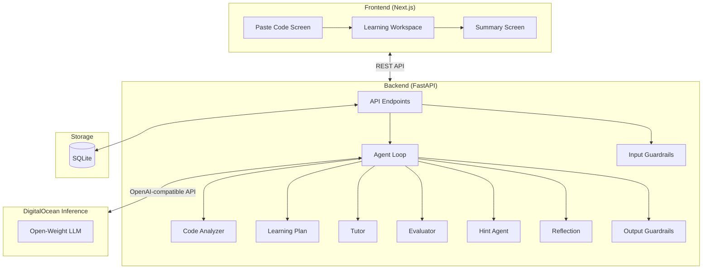

# VibeBreaker

> **Anti-vibe-coding learning tool** — Paste AI-generated code, reconstruct it step by step, and actually learn what you're building.


## What is VibeBreaker?

Students paste AI-generated Python code. VibeBreaker uses open-weight LLMs (via DigitalOcean Inference) to break it into small reconstruction objectives. The student types every line themselves — guided by an AI tutor that **never gives away the answer**.

### How it works
1. **Paste** — Student pastes AI-generated or reference Python code
2. **Break** — AI analyzes the code and creates 5–10 reconstruction objectives
3. **Rebuild** — Student types code for each objective, getting feedback and hints
4. **Reflect** — AI generates a summary with patterns, weak areas, and viva questions

## Architecture



## Getting Started

For step-by-step installation, environment configuration, troubleshooting, and running instructions, please refer to **[SETUP.md](SETUP.md)**.

## Environment Variables

### Backend (`api/.env`)
| Variable | Description | Default |
|----------|-------------|---------|
| `DIGITALOCEAN_INFERENCE_API_KEY` | Your DO Inference API key | *required* |
| `DIGITALOCEAN_INFERENCE_BASE_URL` | Inference endpoint | `https://inference.do-ai.run` |
| `VIBEBREAKER_MODEL_NAME` | Model to use | `qwen2.5-coder-32b-instruct` |
| `DATABASE_URL` | SQLite database path | `sqlite:///./vibebreaker.db` |
| `APP_HOST` | Server host | `0.0.0.0` |
| `APP_PORT` | Server port | `8000` |

### Frontend (`web/.env.local`)
| Variable | Description | Default |
|----------|-------------|---------|
| `NEXT_PUBLIC_API_BASE_URL` | Backend API URL | `http://localhost:8000` |

## API Endpoints

| Method | Endpoint | Description |
|--------|----------|-------------|
| POST | `/api/sessions` | Create session from Python code |
| GET | `/api/sessions/{id}` | Get session state |
| POST | `/api/sessions/{id}/attempt` | Submit code attempt |
| POST | `/api/sessions/{id}/hint` | Request escalating hint |
| POST | `/api/sessions/{id}/finish` | Get reflection summary |
| GET | `/health` | Health check |

## Demo Snippet

Use the built-in "Load demo snippet" button, or paste this student grade analyzer:

```python
def calculate_statistics(scores):
    """Calculate basic statistics for a list of scores."""
    if not scores:
        return None

    total = sum(scores)
    count = len(scores)
    average = total / count

    sorted_scores = sorted(scores)
    mid = count // 2
    if count % 2 == 0:
        median = (sorted_scores[mid - 1] + sorted_scores[mid]) / 2
    else:
        median = sorted_scores[mid]

    highest = max(scores)
    lowest = min(scores)

    return {
        "average": round(average, 2),
        "median": median,
        "highest": highest,
        "lowest": lowest,
        "count": count
    }


def get_letter_grade(score):
    """Convert numeric score to letter grade."""
    if score >= 90:
        return "A"
    elif score >= 80:
        return "B"
    elif score >= 70:
        return "C"
    elif score >= 60:
        return "D"
    else:
        return "F"


def generate_report(student_name, scores):
    """Generate a formatted report for a student."""
    stats = calculate_statistics(scores)
    if stats is None:
        return f"No scores available for {student_name}."

    grades = [get_letter_grade(s) for s in scores]
    grade_counts = {}
    for g in grades:
        grade_counts[g] = grade_counts.get(g, 0) + 1

    report = f"Report for {student_name}\n"
    report += f"{'=' * 30}\n"
    report += f"Scores: {scores}\n"
    report += f"Average: {stats['average']}\n"
    report += f"Median: {stats['median']}\n"
    report += f"Highest: {stats['highest']}\n"
    report += f"Lowest: {stats['lowest']}\n"
    report += f"Grade Distribution: {grade_counts}\n"

    return report


if __name__ == "__main__":
    student_scores = [85, 92, 78, 95, 88, 76, 90, 82]
    print(generate_report("Alice", student_scores))
```

This produces 5–10 reconstruction steps covering: function definitions, conditionals, dictionary operations, list comprehensions, string formatting, and program entry points.

## Project Structure

```
vibebreaker/
├── web/                        # Next.js frontend
│   ├── app/
│   │   ├── page.tsx            # Main page (state machine)
│   │   ├── layout.tsx          # Root layout
│   │   └── globals.css         # Global styles
│   ├── components/
│   │   ├── Header.tsx          # Top bar with branding
│   │   ├── PasteCodeScreen.tsx # Code input screen
│   │   ├── MonacoEditor.tsx    # Monaco wrapper
│   │   ├── LearningWorkspace.tsx # Main learning UI
│   │   └── SummaryScreen.tsx   # Reflection/summary
│   ├── lib/
│   │   └── api.ts              # API client + types
│   └── package.json
├── api/                        # FastAPI backend
│   ├── app/
│   │   ├── main.py             # FastAPI app + endpoints
│   │   ├── agents/
│   │   │   ├── agent_loop.py   # Hermes-style agent loop
│   │   │   └── prompts.py      # Agent prompt templates
│   │   ├── models/
│   │   │   └── schemas.py      # Pydantic models
│   │   ├── db/
│   │   │   └── database.py     # SQLite schema + helpers
│   │   ├── services/
│   │   │   ├── llm_client.py   # DO Inference client
│   │   │   └── session_service.py # Business logic
│   │   └── guardrails/
│   │       ├── input_guardrails.py  # Input validation
│   │       └── output_guardrails.py # Output sanitization
│   ├── requirements.txt
│   └── .env.example
├── docs/
│   ├── architecture.md
│   └── demo-script.md
└── README.md
```

## Deploying to DigitalOcean

### App Platform (recommended)

1. Push code to a GitHub repo
2. Create a DigitalOcean App Platform app
3. Add two components:
   - **Backend**: Python, source `vibebreaker/api`, run command `uvicorn app.main:app --host 0.0.0.0 --port 8080`
   - **Frontend**: Node.js, source `vibebreaker/web`, build command `npm run build`, run command `npm start`
4. Set environment variables in the App Platform dashboard
5. Update `NEXT_PUBLIC_API_BASE_URL` to point to the backend component URL

### Droplet

```bash
# On your Droplet
git clone <your-repo>
cd vibebreaker

# Backend
cd api
python -m venv venv && source venv/bin/activate
pip install -r requirements.txt
cp .env.example .env && nano .env  # Add your API key
uvicorn app.main:app --host 0.0.0.0 --port 8000 &

# Frontend
cd ../web
npm install
npm run build
NEXT_PUBLIC_API_BASE_URL=http://<droplet-ip>:8000 npm start &
```

## License

MIT — Built for a hackathon 🚀
